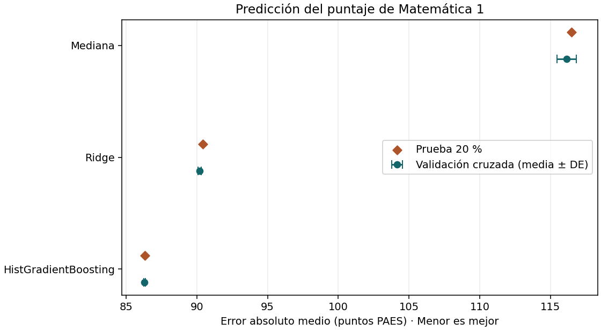

# Predicción del puntaje PAES de Matemática 1

**Sistemas de Información · Grupo 5**  
**Integrante identificado:** Andrés Rafael Ordóñez Neyra.

El programa entrena y compara tres modelos de regresión y estima el puntaje M1 de un perfil ingresado en JSON. La corrida incluida utilizó **246.014 registros con puntaje válido**. El mejor modelo obtuvo **86,33 puntos de error absoluto medio** en los datos de prueba.

## 1. Introducción

El objetivo es estimar el puntaje de la Prueba de Competencia Matemática 1 (M1) en la rendición regular del proceso de admisión PAES 2026 de Chile. Es un problema de **regresión supervisada** porque el programa aprende de ejemplos con un puntaje observado y devuelve una estimación numérica. El escenario usa antecedentes académicos y socioeconómicos disponibles antes de la rendición.

## 2. Base de datos, características y etiqueta

| Archivo de origen | Registros | Uso |
| --- | ---: | --- |
| `A_INSCRITOS_PUNTAJES_PAES_2026_PUB_MRUN.csv` | 320.087 | Etiqueta y antecedentes académicos |
| `B_SOCIOECONOMICO_DOMICILIO_PAES_2026_PUB_MRUN.csv` | 320.087 | Región de domicilio y decil de ingreso familiar |

La documentación de los campos está en los PDF de estructura de registro incluidos en los dos archivos RAR originales.

| Papel | Campos | Significado |
| --- | --- | --- |
| Etiqueta | `MATE1_REG_ACTUAL` | Puntaje M1 de la rendición regular actual, en la escala de 100 a 1.000 |
| Numéricas | `PROMEDIO_NOTAS`, `PTJE_NEM`, `PTJE_RANKING`, `ANYO_DE_EGRESO` | Promedio de educación media, puntaje NEM, puntaje de ranking y año de egreso |
| Categóricas académicas | `RAMA_EDUCACIONAL`, `DEPENDENCIA`, `CODIGO_REGION_EGRESO` | Modalidad, dependencia del centro educativo y región de egreso |
| Categóricas socioeconómicas | `CODIGO_REGION_DOMICILIO`, `INGRESO_PERCAPITA_GRUPO_FA` | Región de domicilio y decil de ingreso familiar por persona |
| Clave de cruce | `MRUN` | Identificador usado únicamente para vincular ambos archivos |

## 3. Preprocesamiento

- Los archivos CSV usan punto y coma. Se comprueba que el `MRUN` sea único en cada archivo y se hace un cruce izquierdo desde los registros con etiqueta válida. Todos esos registros encontraron su contraparte socioeconómica.
- Se excluyeron 54.577 registros con puntaje cero y 19.496 sin puntaje numérico. Quedaron **246.014** registros.
- Se normalizaron los decimales del promedio de notas y se marcaron como faltantes los valores numéricos fuera de los rangos del proyecto. Para las categorías se eliminaron espacios y se asignó `SIN_DATO` a valores ausentes o fuera del catálogo. El código 99 de ingreso significa «Prefiero no responder» y se trató como faltante. Hubo 61.626 casos sin decil utilizable entre quienes tenían puntaje válido.
- Los modelos Ridge y de boosting imputan la mediana y estandarizan las variables numéricas. Las categorías se codifican con one-hot y se admiten niveles desconocidos. Las transformaciones que aprenden de los datos se ajustan dentro de cada pliegue de entrenamiento.
- La lista de características excluye los puntajes de otras pruebas, los máximos históricos, las respuestas correctas o erradas y otras variables posteriores a la rendición. El modelo recibe nueve campos predictores.

## 4. Algoritmos

| Modelo | Tipo y configuración |
| --- | --- |
| Mediana | Línea base. Devuelve siempre la mediana del puntaje observado en el tramo de entrenamiento. |
| Ridge | Regresión lineal supervisada con penalización L2 y `alpha=10`. |
| HistGradientBoosting | Regresión supervisada mediante árboles aditivos. Usa 160 iteraciones, hasta 31 hojas por árbol y una tasa de aprendizaje de 0,1. Permite aprender relaciones no lineales e interacciones. |

## 5. Validación

Se reservó aleatoriamente el **20 %** de los registros para prueba (49.203 casos). Con el **80 % restante** (196.811 casos) se hizo una validación cruzada de tres pliegues aleatorios. La semilla de ambas particiones fue **42**. Se seleccionó el modelo por el menor MAE medio de validación y se ajustó cada modelo con el 80 % completo antes de medir su desempeño en la misma partición de prueba.

| Métrica | Interpretación |
| --- | --- |
| MAE | Promedio de los errores absolutos en puntos PAES. Es el criterio principal. |
| RMSE | Raíz del error cuadrático medio, en puntos PAES. Da más peso a errores grandes. |
| R² | Fracción de variación explicada respecto a predecir la media del conjunto evaluado. Un valor negativo indica un error cuadrático superior al de esa referencia. |

## 6. Corridas de los algoritmos

Resultados obtenidos al entrenar con los dos archivos entregados. La desviación estándar (DE) se calcula entre los tres pliegues.

| Modelo | MAE validación cruzada (media ± DE) | MAE prueba | RMSE prueba | R² prueba |
| --- | ---: | ---: | ---: | ---: |
| Mediana | 116,13 ± 0,69 | 116,50 | 149,72 | −0,0444 |
| Ridge | 90,20 ± 0,11 | 90,41 | 112,95 | 0,4056 |
| **HistGradientBoosting** | **86,31 ± 0,06** | **86,33** | **108,90** | **0,4475** |



Los resultados auditables están en [métricas completas](resultados/metricas.csv), [métricas por pliegue](resultados/pliegues.csv) y [resumen de la base y la partición](resultados/resumen.json).

### Reproducir el entrenamiento y una predicción

1. Usa Python 3.12 y crea un entorno virtual con `python -m venv .venv`. Actívalo en PowerShell con `.\.venv\Scripts\Activate.ps1` o en Bash con `source .venv/bin/activate`.
2. Extrae los dos RAR. Coloca los dos CSV en una carpeta llamada `datos` dentro del proyecto.
3. Ejecuta cada comando desde la carpeta del proyecto. Los comandos son de una sola línea.

```console
python -m pip install -r requirements.txt
python paes.py entrenar --puntajes datos/A_INSCRITOS_PUNTAJES_PAES_2026_PUB_MRUN.csv --socioeconomico datos/B_SOCIOECONOMICO_DOMICILIO_PAES_2026_PUB_MRUN.csv
python paes.py predecir --perfil ejemplos/perfil.json
```

El entrenamiento genera en `salida/` el modelo ganador, las tablas, el resumen y el gráfico. Con `--salida` puedes usar otra carpeta. En ese caso indica la ruta del modelo con `--modelo` al predecir. Usa el JSON de ejemplo como plantilla. Los campos ausentes se tratan como faltantes, por lo que conviene completar toda la información disponible.

## 7. Conclusiones

- **HistGradientBoosting fue el mejor de los tres modelos evaluados.** En prueba redujo el MAE en **30,16 puntos (25,9 %)** respecto a la mediana y en **4,08 puntos (4,5 %)** respecto a Ridge.
- El modelo ganador explicó aproximadamente el **44,75 %** de la variación del puntaje en prueba. El error absoluto medio de 86,33 puntos describe el desempeño agregado y puede variar entre perfiles.
- La evaluación se limita a quienes obtuvieron un puntaje válido en la rendición regular de M1 del proceso 2026. La partición aleatoria puede incluir postulantes del mismo centro educativo en entrenamiento y prueba. Una evaluación en otra cohorte o con centros separados permitiría medir la generalización.
- Los resultados corresponden a la combinación de variables académicas y socioeconómicas. Para medir cuánto aportan los dos campos socioeconómicos se necesitaría repetir la comparación con y sin esos campos bajo las mismas particiones.
